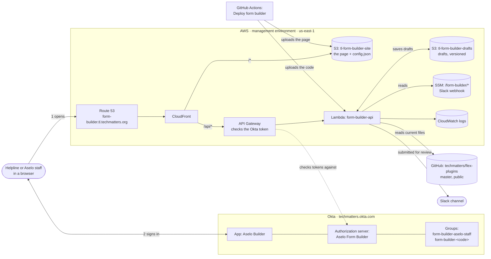
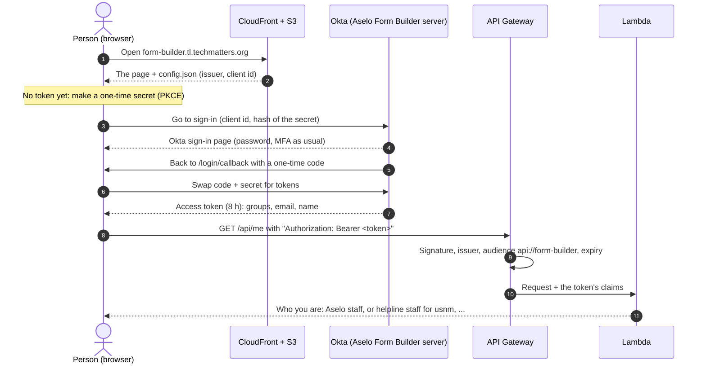

# Aselo Builder: how it works

For the Aselo technical team. How to use the builder is in [user-guide.md](user-guide.md); the
step-by-step setup is in [../terraform/README.md](../terraform/README.md).

## What it is

The form builder is a website where helpline staff and Aselo staff change a helpline's Aselo
configuration without editing JSON: contact and case forms, issue categories, call types, canned
responses, automatic messages, the webchat form, client profiles, and (Aselo staff only) the Flex
service configuration.

It never changes Aselo directly. Changes are kept as a **draft**. They only reach counselors after
Aselo staff turn the draft into a pull request (PR) on `flex-plugins`, it's reviewed and merged, and
it's deployed the usual way. **The repo's `master` branch stays the source of truth.**

## The parts

| Part | What it does | Where it's defined | Created by |
|---|---|---|---|
| **The page** | The whole editor runs in the browser (React). Previews ("Try it out in Aselo") are drawn in the page; nothing is sent to Flex. | `form-builder/src` | Built and uploaded by the deploy workflow |
| **Route 53 record + certificate** | `form-builder.tl.techmatters.org`, HTTPS certificate validated through DNS | `terraform/modules/aws/main.tf` | Terraform, `aws` stage |
| **CloudFront** | One address for everything: the page from S3, `/api/*` to API Gateway. A small function sends paths like `/login/callback` to `index.html`. Adds standard security headers. | `terraform/modules/aws/site.tf` | Terraform, `aws` stage |
| **S3 site bucket** (`tl-form-builder-site`) | The built page, plus `config.json` (the Okta issuer and client id; not secret). Private: only CloudFront can read it. | `site.tf` | Bucket: Terraform. Files: the deploy workflow (`config.json`: Terraform) |
| **API Gateway** (HTTP API) | Refuses any `/api/*` request without a valid access token from the builder's Okta authorization server. Light throttling (20 requests/s). | `terraform/modules/aws/api.tf` | Terraform, `aws` stage |
| **Lambda** (`form-builder-api`) | The API: who you are, the helpline's current files, drafts, submit. Same code as the local dev server (`server/api.ts`), started from `server/lambda.ts`. | `form-builder/server` | Function: Terraform (placeholder code). Code: the deploy workflow |
| **S3 drafts bucket** (`tl-form-builder-drafts`) | One file per draft: `drafts/<code>/<version>/draft.json`. Private, versioned; old versions kept 90 days. | `api.tf` | Terraform, `aws` stage |
| **SSM** (`/form-builder/slack_webhook_url`) | The Slack webhook (secret). Optional: without it, submissions are only logged. | Parameter Store | By hand, in the AWS console |
| **CloudWatch logs** | The Lambda's logs (errors, failed Slack messages), kept 30 days | `api.tf` | Terraform, `aws` stage |
| **Okta app** (*Aselo Builder*, with the logo in `terraform/modules/okta/logo.png`) | The sign-in. Single-page app with PKCE, no client secret. | `terraform/modules/okta/main.tf` | Terraform, `okta` stage |
| **Okta authorization server** (*Aselo Form Builder*) | Issues the builder's access tokens (8 hours) with the person's `groups`, `email` and `name`. Only gives tokens to this app. Doesn't touch Okta's other servers. | `terraform/modules/okta/main.tf` | Terraform, `okta` stage |
| **Okta groups** | `form-builder-aselo-staff`; `form-builder-<code>` per helpline using the builder (none yet). Members are added by hand. | `terraform/okta/terragrunt.hcl` (`helplines`) | Terraform, `okta` stage |
| **flex-plugins master** | Where the current files come from: form definitions, the helpline's service configuration, the webchat settings. Read without credentials (public repo). | — | — |
| **Deploy workflow** | On each push to the branch that touches `form-builder/`: typecheck, tests, build, upload the page and the Lambda's code, refresh CloudFront | `.github/workflows/form-builder-deploy.yml` | — |

### Where the current files come from

The Lambda doesn't use the deployed form definitions (the `assets-<env>` buckets). It reads
`flex-plugins` **master**, because drafts become PRs against master:

1. Every 30 seconds at most, it asks GitHub which commit `master` is on (the git protocol's ref
   list, as `git ls-remote` does; no API rate limit, no credentials).
2. When master has moved, it downloads that commit (about 5 MB) and unpacks only
   `lambdas/packages/hrm-form-definitions/form-definitions`, `twilio-iac/helplines` and
   `aselo-webchat-react-app/configSrc` into the Lambda's temporary storage.
3. The rest of the server reads those folders exactly as it reads a local checkout.

So a merged PR shows up in the builder within about 30 seconds, without a deploy. (What counselors
see still depends on the usual deploys: form definitions to S3, the webchat, `make
service-config-apply`.)

## Signing in

The page signs in with Okta using the authorization code flow with PKCE (no client secret in the
browser). API Gateway checks every API call's token before the Lambda runs; the Lambda reads the
person's role from the token's `groups`.

- **Roles come from the groups in the token.** `form-builder-aselo-staff` means Aselo staff (every
  helpline, staff-only settings, the service configuration). `form-builder-usnm` means helpline
  staff for USNM, and so on. Someone in none of them can sign in to Okta but the API answers
  "Ask the Aselo team for access".
- **Tokens are kept per browser tab** (session storage) and last 8 hours. After that the next
  action signs in again, usually without a password because Okta still has a session.
- **Sign out** clears the tab's token and signs out of Okta.
- **Locally** (`npm run dev`) there's no `config.json`, so there's no sign-in and you're Aselo staff
  (or helpline staff with `FORM_BUILDER_ROLE=helpline-staff FORM_BUILDER_HELPLINES=usnm`).

## What the API enforces

| Rule | Where |
|---|---|
| Only people in a `form-builder-*` group get in | API Gateway (token) + `server/lambda.ts` |
| Helpline staff only open their own helplines | `server/api.ts` |
| Only Aselo staff see or change the service configuration; helpline staff never see it, and can't overwrite or discard Aselo staff's service configuration changes in a shared draft | `server/api.ts` |
| Two people can't overwrite each other's draft: each save carries the revision it started from; a stale save is refused and the person reloads | `server/api.ts` |
| File paths in a draft can't leave the helpline's folders | `server/drafts.ts` |
| Other Aselo-staff-only edits (renaming saved field names, PII on existing fields, removing sections, ...) | **The page only, by decision**: users are staff, misuse would only affect their own helpline's forms, and every draft is reviewed by Aselo staff before it's applied |

## Permissions used

| Who / what | Used for | Permissions |
|---|---|---|
| Okta service app `aselo-terraform` (Terraform's Okta login, keys in SSM `/terraform/okta/terraform_service_app/*`) | Applying the `okta` stage | Scopes `okta.apps.read/manage`, `okta.groups.read/manage`, `okta.authorizationServers.read/manage`, `okta.policies.read`. Admin roles: Application Administrator, a custom group-management role, **API Access Management Administrator** (added for the builder) |
| AWS role `tf-twilio-iac-production` | The `okta` stage's state (`tl-terraform-state-production`, `twilio/okta-form-builder/`) and reading the Okta SSM keys; the `aws` stage reads the Okta outputs through it | Existing role, unchanged |
| AWS role `tf-admin` | Applying the `aws` stage; its state in `tl-terraform-state-management` (`form-builder/aws/`) | Existing role (the one infrastructure-config's management environment uses) |
| Lambda role `form-builder-api` | Running the API | Its own log group; list/read/write/delete in the drafts bucket; read `/form-builder/*` in SSM. Nothing else |
| IAM user `github-actions` (the repo's existing GitHub secret) | The deploy workflow | Extra policy `form-builder-deploy`: write the site bucket, update the Lambda's code, refresh this CloudFront distribution (and list distributions to find it). Nothing else of the builder |
| CloudFront | Reading the page | Bucket policy: only this distribution can read the site bucket |
| Who ran what | Okta and AWS applies: Alejandro, from the devops node (`make plan` / `make apply`) | — |

Not stored anywhere in the repo (it's public): secrets, and the Okta ids (the `aws` stage reads them
from the `okta` stage's state).

## How it was built

| Step | How |
|---|---|
| Okta app, server, claims, policy, group | `form-builder/terraform/okta` on the devops node: `make plan`, `make apply` |
| AWS resources | `form-builder/terraform/aws` on the devops node: `make plan`, `make apply` |
| The page and the Lambda's code | Push to `alejandro-c/flow_designer` (or re-run **Deploy form builder** in GitHub Actions) |
| Slack webhook | Created in Slack; URL stored by hand in SSM `/form-builder/slack_webhook_url` |
| People | Added by hand to the Okta groups |

## Future steps

1. **Apply from the builder** (after the proof of concept is approved): a GitHub App owned by the
   `techmatters` organization (needs an org owner), with *Contents* and *Pull requests* write on
   `flex-plugins` only. Then **Apply** opens the branch and PR itself, with the change log as its
   description. The code is ready (`server/githubApplier.ts`); steps in
   [../terraform/README.md](../terraform/README.md).
2. **Merge to master.** Then switch the deploy workflow from "every push to the branch" to manual
   (or pushes to master).
3. **Helpline staff.** Add a helpline's code to `helplines` in `terraform/okta/terragrunt.hcl`,
   apply, and put its staff in `form-builder-<code>`. Optionally a group rule so membership
   follows the helpline's organization or email domain (Okta Super/Org Admins only).
4. **Slack webhook** if it isn't set yet; email notifications only if Slack isn't enough.
5. **Server-side checks of the Aselo-staff-only edits** (future improvement, see above).
6. **Data fixes found while building**: duplicate field names in eumc, zm and nzba (listed in the
   README); they need a check of saved data and reporting before renaming.
7. **Monitoring**: the Lambda's logs to Datadog, and an alert on API errors.
8. **Drafts and master moving underneath.** A draft remembers each file as it was when it was
   changed (base hashes). If master changes that file afterwards, opening the draft **drops the
   draft's changes to that file** and says which files, so nobody overwrites newer work by
   accident. That also happens after the draft's own PR is merged, which is one more reason to
   discard drafts once they're merged. A gentler merge (keep the changes that don't clash) would
   be an improvement.
