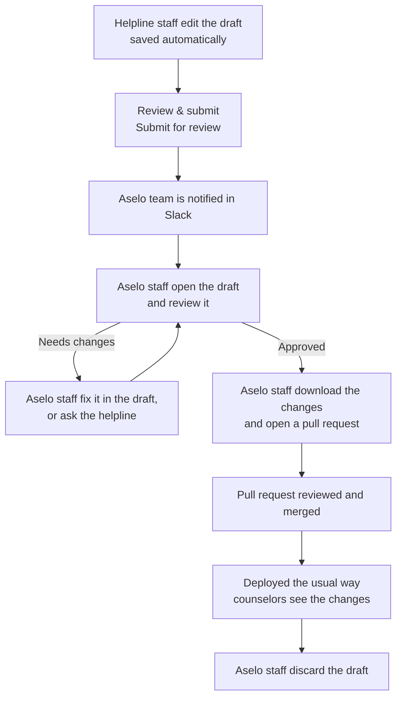

# Form builder: user guide

The form builder is a website for changing how a helpline's Aselo looks and works for counselors:
contact forms, issue categories, call types, canned responses, automatic messages, the webchat
form, case sections and client profiles.

**Address:** https://form-builder.tl.techmatters.org

Changes don't reach counselors straight away. They're saved as a **draft**, checked by the Aselo
team, and then published. You can't break anything in Aselo by trying things out in the builder.

How it works behind the scenes is in [architecture.md](architecture.md).

## The workflow at a glance

| Step | Who | Where |
|---|---|---|
| Make changes | Helpline staff (or Aselo staff) | The builder |
| Submit for review | Helpline staff | The builder |
| Review, fix, approve | Aselo staff | The builder |
| Pull request, merge, deploy | Aselo staff | GitHub and the usual deploy steps |
| Clear the draft | Aselo staff | The builder |

## Getting access

You sign in with your Aselo Okta account. What you can do depends on your Okta group, which the
Aselo team sets:

| Group | You are | You can |
|---|---|---|
| `form-builder-aselo-staff` | Aselo staff | Open every helpline, change everything (including settings that affect saved data and the service configuration), and publish changes |
| `form-builder-<helpline code>`, e.g. `form-builder-usnm` | Helpline staff | Open your helpline, change its forms, and submit changes for review |

If the builder says *"You are not in a form builder group"*, ask the Aselo team
(support@aselo.org) to add you.

## For helpline staff

### 1. Sign in and choose your helpline

Open https://form-builder.tl.techmatters.org. You're sent to the Okta sign-in page, then back to
the builder. Choose your helpline at the top (and the version, if there's more than one). The
start page also lists **Your drafts**.

Your name and role are at the top right, with **Sign out**. You stay signed in for 8 hours in that
browser tab.

### 2. Make your changes

The left menu has everything you can change:

- **Contact forms**: the contact form tabs (e.g. caller and child information) and **Issue
  categories**.
- **Chats and calls**: **Call types**, **Canned responses**, **Automatic messages**, **Webchat
  form**.
- **Cases**: **Sections**, **Case statuses**, and each case section's form (if your helpline uses
  cases).
- **Client profiles**: **Profiles** (if your helpline uses them).

Next to most editors there's a preview of how counselors see it. **Try it out in Aselo** opens the
contact form full-screen, as counselors use it.

Things to know:

- **Everything saves by itself.** The bar at the top says *All changes saved*, and how many files
  your draft changes.
- **There's one draft per helpline**, shared by everyone at your helpline and the Aselo team. You'll
  see *Last change by ...* on it. If someone else saves while you're editing, the builder stops
  and asks you to **Reload**, so nobody's work is overwritten silently.
- **Some things are locked**, because contacts and reports already use them: the saved name of an
  existing field, existing call types, existing category names, existing case sections and
  statuses. The Aselo team can change those if needed.
- **Removing a field asks first** and says what else uses it (reports, the webchat form, linked
  dropdowns).
- **Discard draft** throws away all the draft's changes.

### 3. Send it for review

1. Click **Review & submit** (top right).
2. Read the summary: what was added, removed and changed, in plain language.
   - **Fix these first** lists problems that must be fixed before submitting.
   - **Notes for the Aselo team** lists things the reviewer should know; they don't stop you.
3. Click **Submit for review**.

The Aselo team is notified. The draft shows *Submitted for review by (your name)*.

If you change something after submitting, the draft goes back to *In progress*. Submit it again
when you're done.

### 4. What happens next

The Aselo team reviews the draft. They may fix small things themselves, or contact you. Once it's
approved and published, counselors see the changes, and the draft is cleared from the builder.
Ask support@aselo.org if you want to know where a change is.

## For Aselo staff

### Finding work

The start page lists **Drafts** for every helpline, with those **Submitted** first, who changed
them last and when, and how many files they change. Click a draft to open it. Submissions are
also posted in the Slack channel.

### What you see that helpline staff don't

- **Helpline › Features**: switches such as client profiles, canned responses and prepopulation
  mappings.
- **Helpline › Service configuration**: every Flex service configuration setting, what staging and
  production get, and which file it comes from (Aselo defaults, `common.json`, or the environment's
  file). Edit per file, add settings, or edit the files as JSON. Helpline staff never see this, and
  can't overwrite or discard your service configuration changes in a shared draft.
- **Locked settings unlocked**: saved field names, PII on existing fields, switching an existing
  field's kind, renaming existing call types, categories, sections and statuses, removing existing
  sections. These affect saved data and reporting: check before changing them.
- **View as helpline staff** (top right) shows the builder as helpline staff see it.

### Reviewing a draft

1. Open the draft and click **Review & apply**.
2. Read the summary, **Fix these first** (must be fixed) and **Notes for the Aselo team**.
3. To look closer, open the changed sections; **Try it out in Aselo** shows the contact form as
   counselors will use it.
4. Fix anything small directly in the draft (it saves for everyone), or ask the helpline.

### Publishing (for now, by hand)

While the builder is a proof of concept it doesn't write to GitHub, so the last steps are manual:

1. In **Review & apply**, click **Download as zip**. The zip has the changed files laid out like
   the `flex-plugins` repo, and a `CHANGES.md` describing the changes.
2. In a `flex-plugins` checkout, on `master` with the latest changes, make a branch (e.g.
   `alejandro-c/usnm/update_2710`) and unzip at the root of the repo.
3. Check `git diff`, and run `npm test` in `lambdas/packages/hrm-form-definitions`.
4. Commit (e.g. `USNM: Form builder changes`), push and open a PR. Paste `CHANGES.md` as the
   description.
5. Once it's reviewed and merged, deploy as usual. `CHANGES.md` lists what's needed:
   - form definitions: the **Deploy form-definitions to S3** workflow;
   - webchat texts, if they changed: redeploy the helpline's webchat;
   - the service configuration, if it changed: `make service-config-plan` then
     `make service-config-apply` with `HL=<code>` for each environment listed.
6. Back in the builder, **Discard draft**.

Discard after merging. If a draft stays around after its PR is merged, opening it later drops its
changes to the merged files (the builder says which), because those files changed in master
since the draft started.

Later, once the GitHub App is set up, **Apply** will do steps 1 to 4 itself and show the PR link.

### Making changes yourself

You can also make changes directly, without a helpline submitting them: open the helpline, edit,
then publish as above. Your draft is shared with the helpline's staff, so tell them if you're
working on their helpline.

## Questions

**Do counselors see my changes straight away?** No. Only after the Aselo team publishes them and
they're deployed.

**Can two people work on the same helpline?** Yes, but one at a time on the same draft: if someone
else saved in between, you're asked to reload before saving again.

**I made a mistake.** Undo it in the editor, or **Discard draft** to start again. Nothing reaches
counselors until it's published.

**Something doesn't work.** Email support@aselo.org with the helpline, what you were doing and a
screenshot. Put URGENT in the subject only if counselors are affected.
